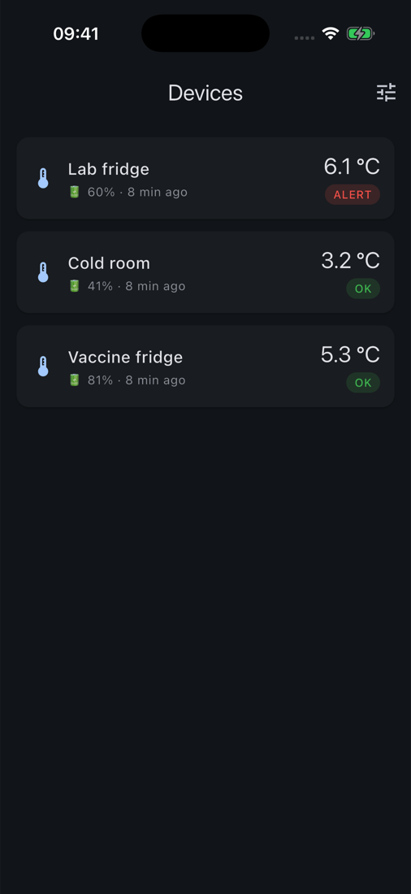
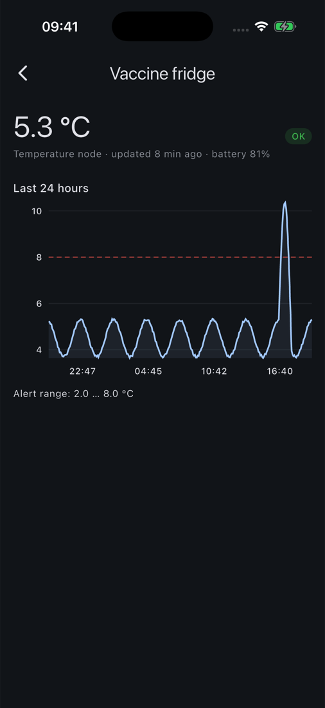
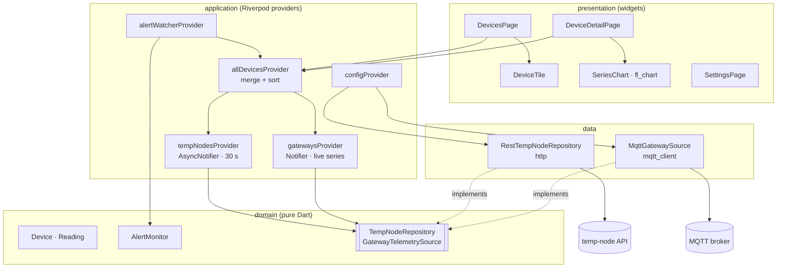

# flutter-iot-dashboard

[](https://github.com/alveskevinn/flutter-iot-dashboard/actions/workflows/ci.yml)


An iOS and Android app for monitoring ESP32 field devices in one place:

- **Battery temperature nodes:** REST, from [esp32-temp-sensor-node](https://github.com/alveskevinn/esp32-temp-sensor-node).
- **Modbus RTU gateways:** live MQTT, from [esp32-modbus-mqtt-gateway](https://github.com/alveskevinn/esp32-modbus-mqtt-gateway).

The app has a device list with problems sorted first, real-time and 24 h charts with alert limits, and notifications when a device leaves its range or stops reporting.

<p align="center">
  
  &nbsp;&nbsp;
  
</p>

## Why

The firmware repos prove the devices work. This app shows what an operator actually needs on their phone: a list that **says what is wrong first**, a chart showing **when** it went wrong, and a single notification for the event, not one every refresh. It also shows how I structure a Flutter codebase that has to talk to two different backends, MQTT and REST, without the UI caring which is which.

## Features

- **Unified device list.** Temperature nodes (REST, polled every 30 s) and gateways (MQTT, pushed) are merged into one model. Alerts and silent devices are sorted to the top. Pull to refresh.
- **Detail screen:**
  - temperature nodes: 24 h chart with dashed min/max limits and battery level;
  - gateways: a live chart of the chosen metric (e.g. `active_power`) plus every value from the last telemetry message.
- **Alerts as transitions.** `AlertMonitor` turns successive snapshots into *out of range* → *back to normal* events, plus *not reporting*. Each event notifies once.
- **Resilient by design.** A REST outage doesn't hide live gateways. Periodic refreshes keep the previous data on screen instead of flashing a spinner. MQTT reconnects and resubscribes automatically.
- **Settings on the device:** API URL, broker, credentials, base topic, the metric to chart and a gateway alert limit.

## Architecture



```text
lib/
├── core/
│   ├── config/            AppConfig + ConfigStore (SharedPreferences)
│   └── notifications/     NotificationService (local notifications)
└── features/
    ├── devices/
    │   ├── domain/        Device, Reading, AlertMonitor, repository interfaces
    │   ├── data/          REST client, MQTT source + pure topic/payload parsers
    │   ├── application/   Riverpod providers (config, sources, merge, alerts)
    │   └── presentation/  pages and widgets
    └── settings/
```

The rule is that dependencies point inwards. `domain` imports nothing from Flutter. `data` implements the domain interfaces. Widgets only read providers. Tests replace whole layers by overriding a single provider.

## How to run

```bash
flutter pub get
flutter test
flutter run   # Android emulator → http://10.0.2.2:3000, iOS simulator → http://localhost:3000
```

To point at another API without opening Settings:

```bash
flutter run --dart-define=API_URL=https://iot.example.com/api/v1
```

### Demo without hardware

```bash
# 1) temperature nodes: API + simulated fleet
git clone https://github.com/alveskevinn/esp32-temp-sensor-node
cd esp32-temp-sensor-node/backend && npm install
npm run dev &          # http://localhost:3000
npm run simulate       # 3 fridges, 24 h of history, one excursion above 8 °C

# 2) gateways: a broker and a fake telemetry publisher
docker run -d -p 1883:1883 eclipse-mosquitto:2 mosquitto -c /mosquitto-no-auth.conf
while true; do
  mosquitto_pub -t devskin/gateways/mbgw-demo/telemetry \
    -m "{\"values\":{\"voltage\":$((225 + RANDOM % 10)),\"active_power\":$((800 + RANDOM % 400))}}"
  sleep 2
done
```

Then open **Settings**, set the broker host (`10.0.2.2` on the Android emulator, `localhost` on the iOS simulator) and save.

## Tests

| Layer | File | What it covers |
|---|---|---|
| domain | `test/domain/alert_monitor_test.dart` | transitions, dedup, recovery, stale/offline, message text |
| data | `test/data/mqtt_parsing_test.dart` | topic matching, payload decoding, LWT status |
| data | `test/data/rest_temp_node_repository_test.dart` | JSON mapping, query building, HTTP errors (`MockClient`) |
| presentation | `test/presentation/devices_page_test.dart` | sorting, alert badge, one notification, navigation, error state |
| end-to-end | `integration_test/app_test.dart` | real app on a simulator against a live API (used for the screenshots above) |

Run the end-to-end test with `flutter drive --driver=test_driver/integration_test.dart --target=integration_test/app_test.dart --dart-define=API_URL=http://localhost:3000/api/v1`.

CI runs `dart format`, `flutter analyze`, `flutter test --coverage`, a debug APK build and an unsigned iOS build on every PR.

## Roadmap

Tracked in [issues](https://github.com/alveskevinn/flutter-iot-dashboard/issues): server push through FCM/APNs, editing device settings from the app (`PATCH /devices/:id`), MQTT over TLS, and offline caching of the last snapshot.

## License

[MIT](LICENSE) © Kevin Pedroso · [DevSkin](https://devskin.com)
